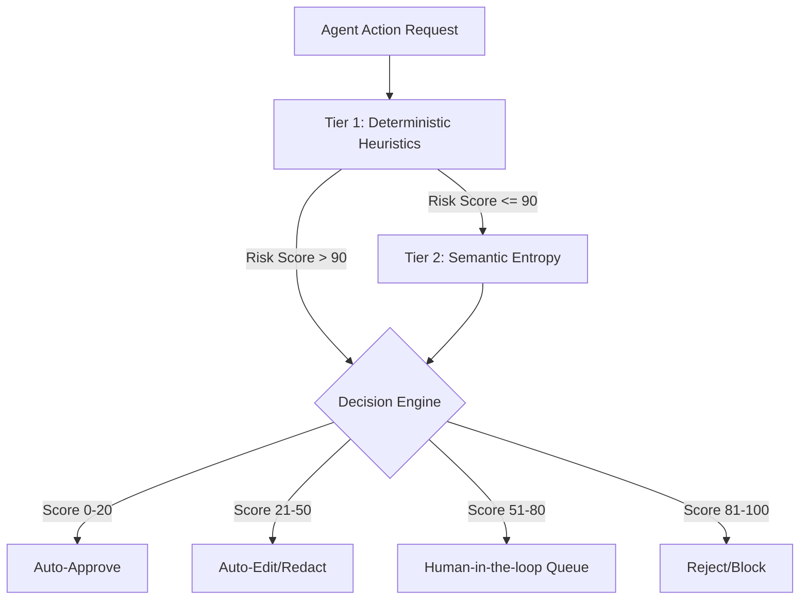

# ControlPlane.AI 🛡️

ControlPlane.AI is a governance middleware that sits between enterprise AI systems and their users. It runs a **two-tier cascade** — sub-10ms deterministic checks followed by confidence-scored deep analysis — before routing every AI action to one of four outcomes: allow, auto-edit, human review, or block.

Unlike single-category checkers, it tags each interaction with overlapping risk signals (privacy, hallucination, bias) rather than forcing one label. It tunes its thresholds per use case and closes the loop by tracking human review overrides, turning every override into a signal for improving detection over time.

## Architecture



## Running the Demo

1. Start the Next.js server:
   ```bash
   npm run dev
   ```

2. Generate simulated AI agent traffic (in a new terminal):
   ```bash
   npm run demo
   ```
   *(This runs `scripts/demo-client.ts`, which fires a mix of safe, high-value, prompt-injected, PII, and biased traces into the API).*

3. Open your browser to [http://localhost:3000/dashboard](http://localhost:3000/dashboard) to watch the live traffic monitor and intervention queue.

## What's Simulated vs. Real

To de-risk the live presentation, this prototype relies on several mocks, while the core routing and UI logic are fully real.

**What is REAL:**
* **Tier 1 Heuristics:** The regex for PII (SSN, credit card) and prompt injection are real executable typescript blocks. The financial cap extraction from the trajectory is real.
* **Score-Banded Routing Engine:** The logic computing the 0-100 score and assigning items to Auto-Approve, Auto-Edit, Review, or Reject is real.
* **Auto-Editing:** The PII redaction (replacing exact matches with `[REDACTED-SSN]`) before queuing is real string manipulation.
* **UI & Data Store:** The dashboard, the intervention queue, and the in-memory trace persistence are real React/Next.js code.

**What is SIMULATED (Mocked):**
* **Agent Trajectories:** We don't have a live LangChain or AutoGen agent connected. We inject hardcoded arrays of `observe` -> `ground` -> `act` JSON objects.
* **Tier 2 LLM Calls:** Instead of calling a real LLM (like OpenAI/Llama) to generate reasoning samples for semantic entropy, we use an `EntropyProvider` interface that returns an array of pseudo-randomly perturbed string templates.
* **Bias Detection:** Rather than a trained fairness classifier, the bias check currently uses a crude heuristic (demographic keywords near decision-outcome verbs). 

## Technology Stack
- Next.js 14 (App Router)
- React Flow (Trajectory Visualization)
- shadcn/ui + Tailwind CSS
- Zod (API Validation)
